 

Informatics student at Pamulang University · Aspiring Software Engineer

01 — TECH STACK

LANGUAGES

FRAMEWORKS & PLATFORMS

DATABASES & TOOLS

## `02` — Featured Projects & Timeline

A timeline of projects reflecting my hands-on growth, architecture exploration, and real-world implementation since **March 2026**.

<table>
<tr>
<td width="50%" valign="top">

### 📍 Service Tracker App
**Cross-Platform Field Solution**
> Real-world service tracking application connecting field operational workflows with a cloud-synced customer database.

- **Stack:** Dart, Flutter, Google Apps Script, Google Sheets DB, GitHub Pages
- **Key Focus:** Serverless REST API, real-time sheet sync, APK distribution & web deployment.
- **Status:** `Production Ready`

<a href="https://github.com/eidhaljoufan/service-tracker"><b>Explore Repository ➔</b></a>

</td>
<td width="50%" valign="top">

### 📦 Net-Install WMS
**Warehouse Operations System**
> Full-stack web application designed to digitize warehouse inventory tracking and field installation operational reporting.

- **Stack:** MongoDB, Express.js, React, Node.js (MERN), Tailwind CSS
- **Key Focus:** RESTful API architecture, role-based access control, real-time stock logs.
- **Status:** `In Active Development`

<a href="https://github.com/eidhaljoufan/net-install-wms"><b>Explore Repository ➔</b></a>

</td>
</tr>
<tr>
<td width="50%" valign="top">

### ⚡ ProductivAction
**Android Task & Productivity App**
> Native mobile productivity application designed to organize daily tasks and support habit-building routines.

- **Stack:** Java, Android SDK, SharedPreferences, XML
- **Key Focus:** Task management, Random Task Selector, Text-to-Speech (TTS), Dark Mode.
- **Status:** `Completed`

<a href="https://github.com/eidhaljoufan/Productivaction"><b>Explore Repository ➔</b></a>

</td>
<td width="50%" valign="top">

### 🧩 Task Manager (SDD)
**Spec-Driven Development**
> Task management project exploring structured requirement translation into clean software implementation.

- **Stack:** JavaScript, Spec-Driven Development Workflow
- **Key Focus:** Requirement-driven task mapping, structured architecture testing.
- **Status:** `Completed`

<a href="https://github.com/eidhaljoufan/task-manager-sdd"><b>Explore Repository ➔</b></a>

</td>
</tr>
</table>

 

  

---

## `03` — Engineering Experience (Production Deliverables)

<strong>🚀 Full-Stack Web Development Projects (March 2026 – Present)</strong>

 

Independently engineered and deployed production-ready dynamic company profile web applications from scratch based on Figma UI/UX prototypes. Focused on custom backend CMS architectures, API integrations, and production server deployments.

* **Key Engineering Highlights:**
  * **Frontend & CMS:** Built custom Laravel Blade interfaces and integrated **Filament PHP** as a dynamic admin panel for project, service, and content updates.
  * **API Integration:** Consumed and integrated **WordPress REST APIs** to dynamically bridge external blog articles and dynamic updates into core web platforms.
  * **Production Deployments:** Managed database implementations (SQL) and cloud domain configuration for live client accessibility.
  * **Live Production Sites:**
    * [Egy Bagus — Civil Engineering Consultant Profile](https://egybagus.com)
    * [Jasa Konsultan SLF — Legal Building Certification Solution](https://jasakonsultanslf.com)

<strong>🔍 QA Engineer & Technical Documentation Intern — PT Mandiri Berkarya Nasional</strong>

 

Contributed to a remote three-member development team ensuring application quality, system reliability, and comprehensive documentation.

* **Key Deliverables:**
  * Formulated structured test plans and system specifications.
  * Performed white-box testing and edge-case validation.
  * Documented issues and collaborated across frontend, backend, and QA workflows to maintain codebase health.

04 — GITHUB ACTIVITY

05 — CURRENT DIRECTION

Focused on strengthening application logic, writing maintainable code, and deepening framework knowledge through real implementation. Exploring Kotlin and TypeScript as relevant next steps while building on existing web, backend, and mobile experience.

LET'S CONNECT

Open to connecting with developers, sharing ideas, and exploring opportunities in software engineering.

  

CONTRIBUTION SNAKE

<picture>
  <source media="(prefers-color-scheme: dark)" srcset="https://raw.githubusercontent.com/eidhaljoufan/eidhaljoufan/output/snake-dark.svg" />
  <source media="(prefers-color-scheme: light)" srcset="https://raw.githubusercontent.com/eidhaljoufan/eidhaljoufan/output/snake.svg" />
  
</picture>

Build with purpose. Engineer with intention.

